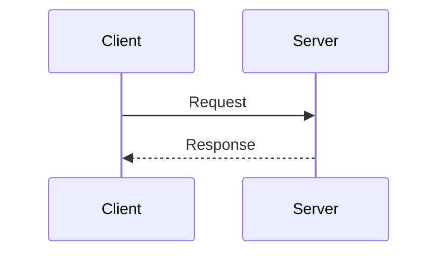

# Practical Architecture

Personal blog and Technical Library at [practical-architecture.com](https://practical-architecture.com) — built with [Hugo](https://gohugo.io) and the [Blowfish](https://blowfish.page) theme, deployed to GitHub Pages via GitHub Actions.

---

## Prerequisites

| Tool | Version | Install |
|---|---|---|
| Hugo Extended | 0.161.1 | `winget install Hugo.Hugo.Extended --version 0.161.1` |
| Go | 1.26+ | already installed |
| Node.js | 22+ | required for the Carbon Sass build |
| Git | any | already installed |

> **Hugo version matters.** Blowfish v2.103.0 requires Hugo 0.158.0–0.161.1. Do not upgrade Hugo without testing the CSS pipeline first.

---

## Local Development

### Start the dev server

```powershell
npm ci --ignore-scripts
npm test
hugo server -D
```

Opens at http://localhost:1313. The `-D` flag renders draft posts so you can preview them before publishing. Changes hot-reload automatically.

Run `npm test` again after changing Sass, Technical Library JavaScript, or an
interactive `flow` diagram. It compiles the Carbon CSS and runs the source-level
checks. Hugo renders blog posts and every technical document from Markdown.

### Build the site locally (production output)

```powershell
npm ci --ignore-scripts
npm test
hugo --gc --cleanDestinationDir
npm run validate:technical-library
```

Output goes to `public/`. Not needed for day-to-day writing — use `hugo server -D` instead.

### Update the Blowfish theme

```powershell
hugo mod get github.com/nunocoracao/blowfish/v2@latest
hugo mod tidy
```

Test thoroughly after upgrading — theme updates can affect CSS and layouts.

---

## Writing Posts

### Create a new Demystified post

**Conceptual topic** (PQC, Zero Trust, Secret Management, Threat Modeling):

```powershell
hugo new --kind demystified-concept demystified/your-topic-here/
```

**Protocol or system topic** (JWT, OIDC, PKI, Kubernetes, SPIFFE/SPIRE, mTLS):

```powershell
hugo new --kind demystified-protocol demystified/your-topic-here/
```

### Create a new Penny for a Thought post

```powershell
hugo new --kind penny-for-a-thought penny-for-a-thought/your-topic-here/
```

### Post lifecycle

All new posts are created with `draft: true`. They are visible locally (`hugo server -D`) but not in production builds.

**To publish a post**, open its `index.md` and change:

```yaml
draft: true   →   draft: false
```

Then commit and push. GitHub Actions deploys automatically.

> **Date gotcha:** Posts dated in the future will not appear in production builds even if `draft: false`. Always set the date to today or earlier when publishing.

### Post front matter reference

```yaml
---
title: "Your Title Here"
date: 2026-06-04          # publish date — must not be in the future
lastmod: 2026-06-04       # last edited date
draft: false              # true = local preview only, false = live
description: ""           # used in search results and link previews
summary: ""               # shown on list pages and series page
series: ["Demystified"]   # or "Penny for a Thought"
series_order: 1           # position within the series
tags: ["tag1", "tag2"]
categories: ["demystified"]  # or "penny-for-a-thought"
showComments: true
showTableOfContents: true    # set false for opinion posts
showHero: true
heroStyle: "big"             # "big" for Demystified, "basic" for Penny
featureAlt: ""               # describe a meaningful hero; leave blank only when decorative
---
```

### Adding a hero image

Place a file named `featured.jpg` (1200×628px, under 300 KB) in the post's folder alongside `index.md`. Blowfish picks it up automatically as the hero and Open Graph image.

```
content/demystified/your-topic/
├── index.md
└── featured.jpg
```

### Adding a diagram (Demystified — Protocol posts)

Inline Mermaid diagrams render without any extra setup:

````markdown

````

---

## Content Structure

```
content/
├── demystified/          # Technical deep-dives
├── penny-for-a-thought/  # Industry opinion pieces
├── posts/                # Auto-aggregated "Browse All Posts" page (do not add posts here directly)
└── docs/                 # Technical Library Markdown, rendered by custom Hugo layouts
```

## Writing Technical Library documents

Blog posts and Technical Library documents use different archetypes and layouts. Use the commands above for blog posts. For the Library, create Markdown with the matching document archetype:

```powershell
hugo new content docs/guides/my-guide/index.md --kind guide
hugo new content docs/runbooks/my-runbook/index.md --kind runbook
hugo new content docs/architecture/my-architecture/index.md --kind architecture
hugo new content docs/adrs/adr-0002-my-decision/index.md --kind adr
hugo new content docs/projects/my-project/index.md --kind project
hugo new content docs/reference/my-reference/index.md --kind reference
```

Set `draft: false` when the document is ready, then commit and push. Hugo
renders the Markdown into the shared Carbon document shell and automatically
adds eligible pages to the `/docs/` catalog; no HTML index edit is required.
`Runbook` is a first-class document type alongside Guide, Architecture, ADR,
Project, and Reference.

### Add Carbon presentation and interactive diagrams

Every Technical Library document uses the same responsive Carbon UI, palette,
navigation, table of contents, code controls, and progressive enhancement. An
optional namespaced `carbon:` front matter map can customize the eyebrow, lead,
hero metadata, callout, and primary button without moving core document
metadata out of its normal top-level fields.

Add an interactive diagram directly to Markdown with a fenced `flow` JSON
block. Hugo validates and renders the structure; shared vanilla JavaScript adds
pan, zoom, fit, pause, and keyboard-focus behavior. The source of truth remains
the bundle's `index.md`—do not create or edit a production HTML copy under
`static/`.

See [TECHNICAL_LIBRARY.md](TECHNICAL_LIBRARY.md) for the complete metadata
contract, `carbon:` example, flow schema, ADR supersession workflow,
related-document links, styling, validation, and future-section instructions.

---

## Deployment

Pushing to `main` triggers an automatic GitHub Actions build and deploy to GitHub Pages. No manual steps needed.

**View deploy status:** https://github.com/That1Guy007/practical-architecture/actions

**Live site:** https://practical-architecture.com

The workflow (`deploy.yml`) builds and tests the Carbon assets, runs Hugo
0.161.1 Extended, validates the generated Technical Library, uploads `public/`,
and uses `baseURL = https://practical-architecture.com/` from `hugo.toml`.

---

## Git Workflow

```powershell
# Stage specific files
git add content/demystified/your-post/index.md

# Commit
git commit -m "publish: add PQC Demystified post"

# Push (uses SSH key)
git push origin-ssh main
```

### Remotes

| Name | URL | Use |
|---|---|---|
| `origin` | https://github.com/That1Guy007/practical-architecture.git | HTTPS |
| `origin-ssh` | git@that1guy-github:That1Guy007/practical-architecture.git | SSH (preferred) |

### Reverting a bad commit

```powershell
git log --oneline -5          # find the commit hash
git revert <hash> --no-edit   # creates a revert commit (safe, keeps history)
git push origin-ssh main
```

---

## Site Configuration

| File | Purpose |
|---|---|
| `config/_default/hugo.toml` | Base URL, taxonomies, output formats |
| `config/_default/params.toml` | Theme appearance, dark mode, logo, search, article layout |
| `config/_default/languages.en.toml` | Site title, description, author bio and social links |
| `config/_default/menus.en.toml` | Navigation bar and footer links |
| `config/_default/markup.toml` | Markdown rendering, syntax highlighting, Mermaid |
| `assets/scss/carbon.scss` | Carbon reset, g100 theme, type tokens, and responsive grid source |
| `assets/scss/site.scss` | Site-specific styling composed from Carbon tokens and mixins |
| `assets/css/carbon.css` | Generated Carbon foundation; rebuild with `npm run build:carbon` |
| `assets/css/custom.css` | Generated site styling; rebuild with `npm run build:carbon` |
| `assets/css/technical-library.css` | Scoped Technical Library layout and component styles |
| `assets/js/technical-library.js` | Catalog filtering and document interactions |
| `assets/js/technical-document.js` | Document navigation and interactive flow behavior |
| `layouts/docs/` | Carbon Technical Library page shell and Markdown render hooks |

### Updating your author bio or social links

Edit `config/_default/languages.en.toml`:

```toml
[params.author]
  name     = "Carlos Hernandez"
  headline = "Clear thinking on complex systems"
  bio      = "..."
  links = [
    { linkedin = "https://www.linkedin.com/in/compscicarlos/" },
    { github   = "https://github.com/That1Guy007" },
    { rss      = "/index.xml" },
  ]
```

### Updating the logo and favicon

The homepage uses the dark-surface vector master at `assets/img/practical-architecture-mark.svg`; `practical-architecture-mark-ink.svg` is the one-color dark-on-light variant, and `practical-architecture-mark-512.png` is the transparent raster fallback. To switch marks, update the `logo` key in `config/_default/params.toml`:

```toml
logo = "img/practical-architecture-mark.svg"
```

Browser icons live alongside it as `favicon.svg`, `favicon.ico`, `favicon-32.png`, and `apple-touch-icon.png`. Keep the favicon artwork simpler than the homepage mark so it stays legible at 16px.

After changing the vector colors or geometry, regenerate the raster variants on Windows:

```powershell
.\scripts\generate-brand-assets.ps1
```

---

## Cross-Posting Checklist

Before sharing a post on LinkedIn or Medium:

1. Confirm the post is live at `https://practical-architecture.com`
2. Test the link preview using https://www.linkedin.com/post-inspector/
3. Wait 24–48 hours before cross-posting (lets Google index the original first)
4. **Medium:** use *Import Story* with your live post URL — sets canonical automatically
5. **LinkedIn:** paste the post URL in the share box for a link preview, or write a LinkedIn Article and add `Originally published at practical-architecture.com` at the top

---

## Archetypes (Post Templates)

| Command flag | Template | Use for |
|---|---|---|
| `--kind demystified-concept` | Demystified — Conceptual | PQC, Zero Trust, Secret Management, Threat Modeling |
| `--kind demystified-protocol` | Demystified — Protocol | JWT, OIDC, PKI, Kubernetes, SPIFFE/SPIRE, mTLS |
| `--kind penny-for-a-thought` | Penny for a Thought | Industry opinions and takes |
| `--kind guide` | Technical Library — Guide | Implementation walkthroughs and technical guidance |
| `--kind runbook` | Technical Library — Runbook | Repeatable operating, recovery, and troubleshooting procedures |
| `--kind architecture` | Technical Library — Architecture | System structure, constraints, flows, and quality attributes |
| `--kind adr` | Technical Library — ADR | MADR-inspired architectural decisions |
| `--kind project` | Technical Library — Project | Portfolio case studies and engineering outcomes |
| `--kind reference` | Technical Library — Reference | Concise lookup material |
