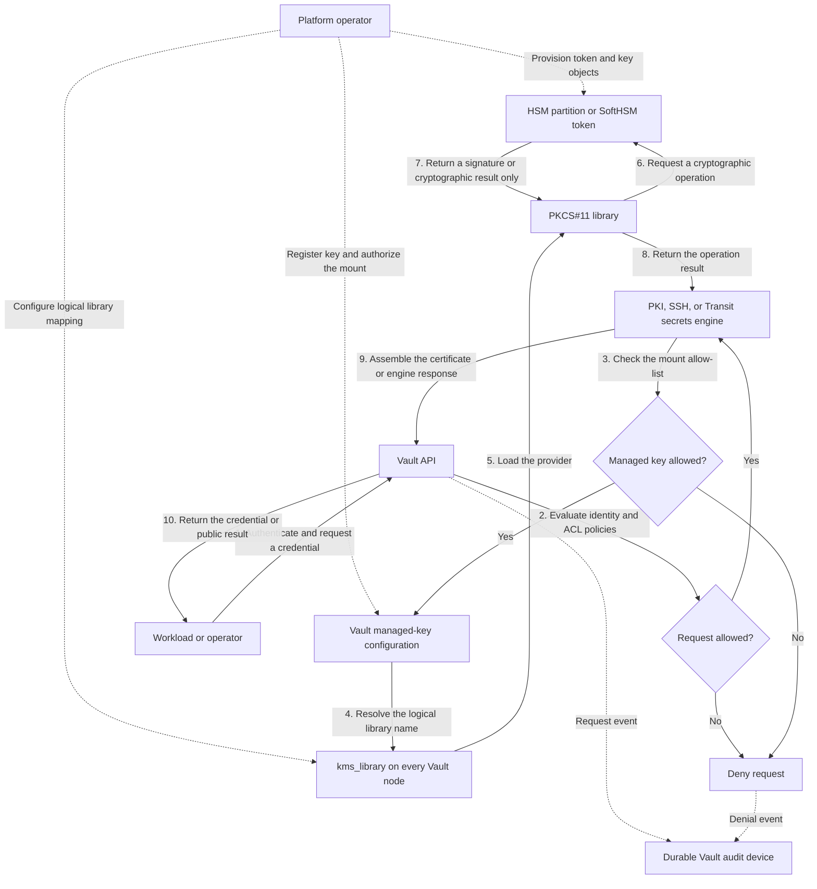

## SoftHSM with Vault: solution overview

## Purpose

This guide is an architecture and implementation aid for teams evaluating
HSM-backed credentials with HashiCorp Vault. It explains where SoftHSM fits,
what it proves, what it does not protect, and how to build a representative
PKCS#11-backed PKI proof of concept without coupling the design to a particular
wrapper or lab tool.

The worked example protects the private keys of a root CA and an issuing CA by
using Vault Enterprise managed keys backed by SoftHSM. The same architectural
questions apply when managed keys back SSH CA or Transit operations, but their
engine-specific setup is outside this walkthrough.

> **SoftHSM is not a hardware security module.** It is a software PKCS#11
> implementation whose token objects are files on the host. It is useful for
> development, API validation, automation tests, and rehearsing migration to a
> vendor HSM. It does not provide a hardware trust boundary, tamper resistance,
> certified key protection, or a meaningful compliance claim.

## Executive summary

The recommended production pattern is:

1. Vault runs the Enterprise HSM-capable binary on every server node.
2. Every Vault node has the vendor's PKCS#11 library and network or appliance
   access to the same highly available HSM service or partition.
3. Vault configuration gives that library a logical name with `kms_library`.
4. A Vault managed-key record maps one Vault name to one key object in the HSM.
5. Only explicitly authorized secrets-engine mounts may use each managed key.
6. Vault asks the HSM to generate or use the private key and delegates signing
   or cryptographic operations to it. The private key is not returned to Vault.
7. HSM and Vault recovery material, policies, audit logs, monitoring, rotation,
   and failure procedures are operated as one service.

Use SoftHSM to prove steps 3 through 6 and to test operational workflows. Move
to a vendor-supported HSM or managed KMS before relying on the design for a
production security boundary.

## What “HSM-backed credentials†means

The phrase can refer to different controls. Decide which one is required before
selecting a design.

| Protection target | Vault mechanism | What the HSM protects | Important limitation |
|---|---|---|---|
| PKI CA credentials | PKI secrets engine with a managed key | Root or intermediate CA private key and signing operations | A leaf key generated by `pki/issue` is still returned by Vault; it is not automatically created in the workload's HSM |
| SSH CA credentials | SSH secrets engine with a managed key | SSH CA private key and certificate signing | Client or host private keys remain the client's responsibility |
| Application cryptography | Transit with a managed key | Supported sign, verify, encrypt, decrypt, or MAC operations | Capabilities vary by backend, mechanism, and Vault version |
| Vault's own master key | PKCS#11 seal | Auto-unseal and, with Enterprise, seal wrapping | This is separate from secrets-engine managed keys |
| Dynamic database or cloud credentials | The corresponding secrets engine | Usually only Vault's seal-wrapped storage, not each generated password or token | An HSM does not make a generated database password an HSM-resident credential |

Two independent configuration blocks are therefore easy to confuse:

- `kms_library "pkcs11"` makes a PKCS#11 library available to **managed
  keys** used by supported secrets engines.
- `seal "pkcs11"` uses a PKCS#11 key for **Vault auto-unseal and seal
  wrapping**.

Using one does not enable the other. A production deployment may use both, but
it should use separate keys and normally separate HSM roles or partitions so a
failure or administrative mistake in one plane does not compromise the other.

## Architecture flow



Dashed lines show provisioning and audit dependencies; solid lines show the
runtime request path. The Vault API remains the policy, identity, audit, and
lifecycle control plane. The PKCS#11 backend is the cryptographic execution and
key-custody plane. Only the cryptographic result returns from the HSM boundary;
the private key does not.

Vault stores the managed-key configuration—including the information required
to reach and authenticate to the backend—but reads of that configuration redact
the PIN.

## Prerequisites and decision gates

Before building the proof of concept, confirm:

- The Vault binary and license include Enterprise HSM managed keys. Community
  Edition cannot configure PKCS#11 managed keys.
- The Vault host architecture, operating system, PKCS#11 library, and GNU
  `libltdl` are compatible.
- The intended HSM supports the required PKCS#11 mechanisms and key sizes.
  This example uses RSA 4096 and `CKM_RSA_PKCS` (`0x0001`).
- Every active and standby Vault node can load the library at the same path and
  reach the same HSM keys.
- The desired secrets engine supports managed keys in the deployed Vault
  version.
- Recovery objectives include the HSM keys, Vault storage, and configuration;
  a Vault snapshot alone is not a complete backup.
- The security team has decided whether the root CA should be online. A common
  production design keeps the root offline and lets Vault serve only an
  HSM-backed intermediate CA.

## Reference proof of concept

The following commands assume a Linux host, a Vault Enterprise HSM binary,
SoftHSM 2, `pkcs11-tool`, `jq`, and a correctly authenticated Vault CLI. Package
names and library paths vary by distribution; discover the installed path
instead of copying it blindly.

The example values use:

- SoftHSM token label: `vault-pki`
- PKCS#11 library logical name: `softhsm`
- Vault managed keys: `pki-root-key` and `pki-intermediate-key`
- PKI mounts: `pki-root` and `pki-intermediate`

### 1. Install and configure SoftHSM

On a Debian-derived test host:

```bash
sudo apt-get update
sudo apt-get install -y softhsm2 opensc libltdl7 jq

dpkg -L softhsm2 | grep 'libsofthsm2\.so$'
```

Create a token directory owned by the same service account that runs Vault:

```bash
sudo install -d -m 0750 -o vault -g vault /var/lib/softhsm/tokens

sudo tee /etc/softhsm2-vault.conf >/dev/null <<'EOF'
directories.tokendir = /var/lib/softhsm/tokens
objectstore.backend = file
log.level = INFO
EOF

sudo chown root:vault /etc/softhsm2-vault.conf
sudo chmod 0640 /etc/softhsm2-vault.conf
```

Initialize the token interactively so the Security Officer PIN and user PIN do
not appear in shell history. SoftHSM reassigns an initialized token to a new
slot, so identify it by label rather than assuming slot `0` remains valid.

```bash
sudo -u vault env SOFTHSM2_CONF=/etc/softhsm2-vault.conf \
  softhsm2-util --init-token --free --label vault-pki

sudo -u vault env SOFTHSM2_CONF=/etc/softhsm2-vault.conf \
  softhsm2-util --show-slots
```

For a containerized Vault deployment, put the configuration, PKCS#11 library,
and token directory inside the Vault container at stable paths. Persist the
token directory independently from the container writable layer. Never bake a
PIN or token database into an image.

### 2. Make the PKCS#11 library available to Vault

Add a logical PKCS#11 library definition to the Vault server configuration on
every node. Replace the path with the one found on the target system.

```hcl
kms_library "pkcs11" {
  name    = "softhsm"
  library = "/usr/lib/softhsm/libsofthsm2.so"
}
```

Ensure the Vault service receives the SoftHSM configuration path:

```ini
[Service]
Environment=SOFTHSM2_CONF=/etc/softhsm2-vault.conf
```

Restart Vault using the deployment's normal rolling-restart procedure, or
reload configuration if the deployed Vault version and changed settings support
it. Validate the cluster remains healthy before continuing.

### 3. Register distinct Vault managed keys

The token user PIN is required when Vault opens the PKCS#11 session. Supply it
through the platform's secret-delivery mechanism. The placeholder below is
deliberately not a usable credential.

```bash
vault write sys/managed-keys/pkcs11/pki-root-key \
  library=softhsm \
  token_label=vault-pki \
  pin='<token-user-pin>' \
  key_label=pki-root-2026 \
  mechanism=0x0001 \
  key_bits=4096 \
  allow_generate_key=true \
  allow_store_key=false \
  any_mount=false

vault write sys/managed-keys/pkcs11/pki-intermediate-key \
  library=softhsm \
  token_label=vault-pki \
  pin='<token-user-pin>' \
  key_label=pki-intermediate-2026 \
  mechanism=0x0001 \
  key_bits=4096 \
  allow_generate_key=true \
  allow_store_key=false \
  any_mount=false
```

`library` is the logical `name` from the `kms_library` stanza, not the shared
object path. `token_label` avoids coupling the configuration to SoftHSM's
reassigned numeric slot. A physical HSM deployment may instead require a slot
number or a vendor-specific topology.

The key objects are generated lazily when first used. Test each mapping; this
also causes key creation when it has not happened yet:

```bash
vault write -f sys/managed-keys/pkcs11/pki-root-key/test/sign
vault write -f sys/managed-keys/pkcs11/pki-intermediate-key/test/sign

vault read sys/managed-keys/pkcs11/pki-root-key
vault read sys/managed-keys/pkcs11/pki-intermediate-key
```

After successful generation, update the managed-key configurations to set
`allow_generate_key=false`. HashiCorp recommends disabling generation after
initial creation to reduce the chance that an absent or misidentified key is
silently replaced. Preserve the other fields when updating the records.

### 4. Create an HSM-backed root and issuing CA

Enable separate mounts. This makes the root's narrow administrative policy and
the intermediate's routine issuance policy easier to reason about and audit.

```bash
vault secrets enable -path=pki-root pki
vault secrets tune -max-lease-ttl=87600h \
  -allowed-managed-keys=pki-root-key pki-root

vault secrets enable -path=pki-intermediate pki
vault secrets tune -max-lease-ttl=43800h \
  -allowed-managed-keys=pki-intermediate-key pki-intermediate
```

Generate the root. Do not pass `key_type` or `key_bits` to the PKI endpoint;
those attributes belong to the managed-key configuration.

```bash
vault write pki-root/root/generate/kms \
  managed_key_name=pki-root-key \
  issuer_name=example-root-2026 \
  common_name='Example Root CA' \
  ttl=87600h
```

Generate the intermediate CSR, sign it with the root, and import the signed
certificate back into the intermediate mount:

```bash
vault write -format=json pki-intermediate/intermediate/generate/kms \
  managed_key_name=pki-intermediate-key \
  common_name='Example Issuing CA' \
  | jq -r '.data.csr' > intermediate.csr.pem

vault write -format=json pki-root/root/sign-intermediate \
  issuer_ref=example-root-2026 \
  csr=@intermediate.csr.pem \
  format=pem_bundle \
  ttl=43800h \
  | jq -r '.data.certificate' > intermediate.cert.pem

vault write pki-intermediate/intermediate/set-signed \
  certificate=@intermediate.cert.pem
```

Configure externally reachable issuing-certificate and CRL URLs, not loopback
addresses copied from a local example:

```bash
vault write pki-root/config/urls \
  issuing_certificates='https://vault.example.com/v1/pki-root/ca' \
  crl_distribution_points='https://vault.example.com/v1/pki-root/crl'

vault write pki-intermediate/config/urls \
  issuing_certificates='https://vault.example.com/v1/pki-intermediate/ca' \
  crl_distribution_points='https://vault.example.com/v1/pki-intermediate/crl'
```

### 5. Define least-privilege issuance

Create a role with a short leaf-certificate lifetime and a constrained
namespace:

```bash
vault write pki-intermediate/roles/workload-tls \
  allowed_domains='svc.example.internal' \
  allow_subdomains=true \
  allow_bare_domains=false \
  allow_ip_sans=false \
  key_type=rsa \
  key_bits=2048 \
  max_ttl=24h
```

Grant workloads only the issue or sign path they need:

```hcl
path "pki-intermediate/issue/workload-tls" {
  capabilities = ["create", "update"]
}

path "pki-intermediate/sign/workload-tls" {
  capabilities = ["create", "update"]
}
```

There are two materially different leaf-key workflows:

- `issue/workload-tls` makes Vault generate and return the leaf private key.
  The CA key is HSM-backed; the leaf key is not.
- `sign/workload-tls` accepts a CSR whose private key was generated by the
  workload. Use this when the workload's leaf key must stay in its own TPM,
  HSM, or other non-exportable keystore.

A simple issuance test is:

```bash
vault write pki-intermediate/issue/workload-tls \
  common_name=api.svc.example.internal \
  ttl=1h
```

Treat the returned private key as a secret. Do not use this response-oriented
workflow if the leaf key is required to be non-exportable.

### 6. Verify the trust boundary

Validation should prove behavior, not merely that configuration records exist:

```bash
vault status
vault secrets list
vault read sys/managed-keys/pkcs11/pki-root-key
vault read sys/managed-keys/pkcs11/pki-intermediate-key

sudo -u vault env SOFTHSM2_CONF=/etc/softhsm2-vault.conf \
  pkcs11-tool --module /usr/lib/softhsm/libsofthsm2.so \
  --token-label vault-pki --login --list-objects

openssl x509 -in intermediate.cert.pem -noout -subject -issuer -dates
```

Also test the negative paths:

- A mount not listed in `allowed_managed_keys` cannot use the key.
- An issuance token cannot administer a managed key or root mount.
- Vault cannot sign while the PKCS#11 provider is unavailable.
- Restoring only Vault storage does not recreate lost SoftHSM token objects.
- A standby can become active and continue signing with the same managed key.

## Production design considerations

### Availability and performance

Managed-key operations add an external synchronous dependency. Size the HSM for
peak signing throughput and latency, and measure the effect of key generation,
certificate issuance, CRL signing, OCSP if used, and rotation. Vault's
`max_parallel` managed-key setting can constrain concurrent HSM operations; set
it from vendor guidance and load testing rather than treating a larger value as
automatically better.

All Vault nodes that may become active need an equivalent `kms_library`
configuration and access to the same key objects. SoftHSM's local file store
does not model a vendor HSM cluster, quorum behavior, network partitions, or
client-session limits. Copying a token directory independently to several live
nodes creates divergent key stores; it is not an HA design.

### Key and token separation

Use a distinct external key for each CA issuer or cryptographic purpose. Separate
root, intermediate, SSH CA, Transit, and Vault-seal keys by role and preferably
by partition where the threat model warrants it. Do not reuse one managed key
for unrelated mounts merely because `any_mount=true` is convenient.

Keep `any_mount=false` and explicitly set each mount's
`allowed_managed_keys`. Bind HSM credentials to the minimum operations and
objects required by Vault. Separate HSM security-officer administration from
Vault administration when dual control is required.

### Secret delivery

The HSM PIN is itself a bootstrap credential. Do not place it in source control,
container images, general-purpose configuration management output, shell
history, or process arguments. Use the deployment platform's protected secret
delivery, restrict access to the Vault service identity, and document how the
PIN is recovered and rotated.

For a Vault PKCS#11 seal, the bootstrap problem is stricter because Vault needs
the seal credential at startup. Managed keys used by a secrets engine and the
seal key should not share a token credential unless the risk has been explicitly
accepted.

### Backup and disaster recovery

A recoverable service needs all of the following:

- Vault Raft snapshots or the supported backup for the selected storage backend.
- HSM-native, vendor-supported key backup or replication.
- Vault server configuration, including the stable logical library name.
- HSM client configuration, trust material, access policy, and partition data.
- A secure record of managed-key names, HSM key labels or IDs, mechanisms, and
  issuer relationships.
- Tested restoration steps that verify signing on a clean recovery environment.

For SoftHSM, all token objects live under the directory configured by
`directories.tokendir`, so that directory must be backed up consistently and
protected like plaintext key custody. Encrypting the backup is necessary, but
it does not turn SoftHSM into hardware-backed storage.

Loss of a CA key prevents new signatures and can prevent timely CRL updates.
Existing certificates and public trust anchors do not disappear, so the incident
plan must cover replacement issuers, trust-store distribution, revocation, and
short-lived-certificate strategy.

### Rotation and migration

Treat rotation as creation of a new key and issuer, not in-place mutation of an
existing key label. A safe outline is:

1. Create a new HSM key object and a new Vault managed-key name.
2. Add the new name to only the target mount's allow-list.
3. Generate a new issuer, cross-sign or sign it as the PKI design requires, and
   validate chains and distribution URLs.
4. Move issuance roles to the new issuer and observe issuance and validation.
5. Keep the old issuer available for validation and revocation through its
   required lifetime.
6. Remove the old key only after every dependency and retention obligation has
   expired.

To migrate from SoftHSM to hardware, keep the Vault-facing logical design but
expect the vendor library path, authentication, slots, supported mechanisms,
HA model, backup process, and key-import policy to change. For the strongest
assurance, generate new keys inside the destination HSM and rotate issuers. A
file copy or software-key import may violate the reason for adopting hardware.

### Audit and monitoring

Enable at least one durable Vault audit device before issuing credentials. Alert
on managed-key administration, mount tuning, issuer changes, root signing,
unusual issuance rates, HSM login failures, session exhaustion, latency, and
provider unavailability. Correlate Vault request IDs with HSM audit events when
the vendor supports it.

Do not log PINs, returned leaf private keys, or complete issuance responses.
Health checks should exercise a low-impact sign/verify path only when its rate
and audit volume are understood.

## Advantages

- CA or application private keys can remain outside Vault's storage and process
  memory during normal use.
- Vault still provides a consistent API, identity system, policy model, audit
  trail, leases, roles, and certificate lifecycle.
- PKCS#11 offers a portable architectural boundary and a realistic path from a
  software test double to a supported hardware device.
- Per-mount allow-lists and separate managed-key records support least privilege
  and independent rotation.
- A SoftHSM proof of concept is inexpensive, reproducible, and suitable for CI
  tests of configuration and failure handling.

## Costs and limitations

- Vault Enterprise HSM licensing and an HSM-capable build are required for
  PKCS#11 managed keys.
- The HSM becomes a runtime dependency with its own latency, throughput,
  availability, upgrade, session, and support constraints.
- SoftHSM protects keys only with host file permissions and optional backup
  encryption; an administrator who can copy the token store can copy the keys.
- PKCS#11 compatibility is not uniform. Mechanisms, generation, object
  attributes, failover behavior, and tooling vary by vendor.
- Backup and recovery now span at least two stateful systems. Losing either the
  Vault metadata or the HSM key can make the service unusable.
- HSM-backed issuer keys do not automatically make workload leaf keys
  non-exportable.
- Operational separation, dual control, key ceremonies, and evidence collection
  add process cost that a lab cannot validate.

## Recommended adoption path

1. **Define the claim.** State exactly which keys must be hardware-backed and
   which compliance or threat-model requirement this satisfies.
2. **Build the SoftHSM proof of concept.** Exercise setup, issuance, ACLs,
   failover, loss of the PKCS#11 provider, backup, restore, and rotation.
3. **Select and validate the production HSM.** Confirm Vault and vendor support,
   mechanisms, architecture, HA, authentication, capacity, audit, and backup.
4. **Rehearse with production-equivalent topology.** Use all Vault nodes,
   realistic load, actual secret delivery, monitoring, and recovery tooling.
5. **Migrate with new keys.** Generate them in hardware, introduce new issuers,
   move consumers deliberately, and retain old trust material as required.
6. **Operate continuously.** Test restore and rotation on a schedule, monitor
   capacity and errors, and review permissions and dependency versions.

## References

- [Vault managed keys overview](https://developer.hashicorp.com/vault/docs/enterprise/managed-keys)
- [Vault `kms_library` configuration](https://developer.hashicorp.com/vault/docs/configuration/kms-library)
- [Vault managed keys API](https://developer.hashicorp.com/vault/api-docs/system/managed-keys)
- [Vault PKI with managed keys tutorial](https://developer.hashicorp.com/vault/tutorials/pki/managed-key-pki)
- [Vault PKI design considerations](https://developer.hashicorp.com/vault/docs/secrets/pki/considerations)
- [Vault PKCS#11 seal configuration](https://developer.hashicorp.com/vault/docs/configuration/seal/pkcs11)
- [SoftHSM project documentation](https://github.com/softhsm/SoftHSMv2)

<!-- ## Executive summary

## Context

## Goals and non-goals

## Constraints and assumptions

## Architecture


## Component responsibilities

## Data and control flows

## Security and trust boundaries

## Reliability and operations

## Decisions and tradeoffs

## Related documentation -->
